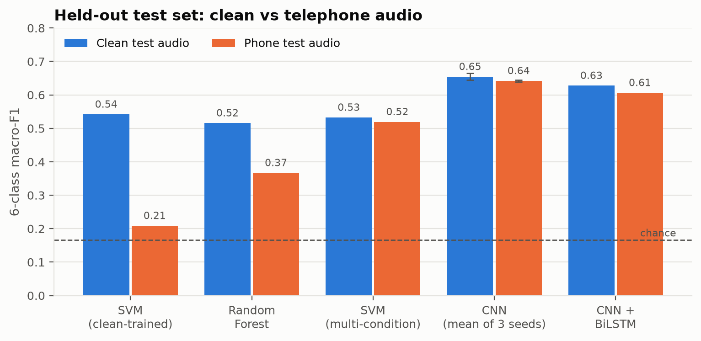
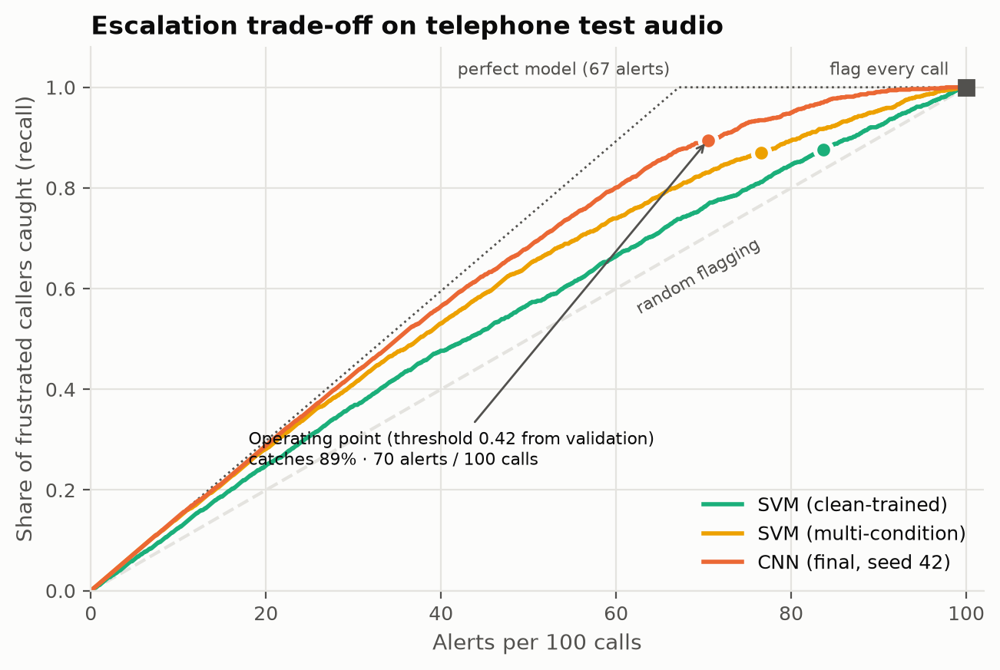
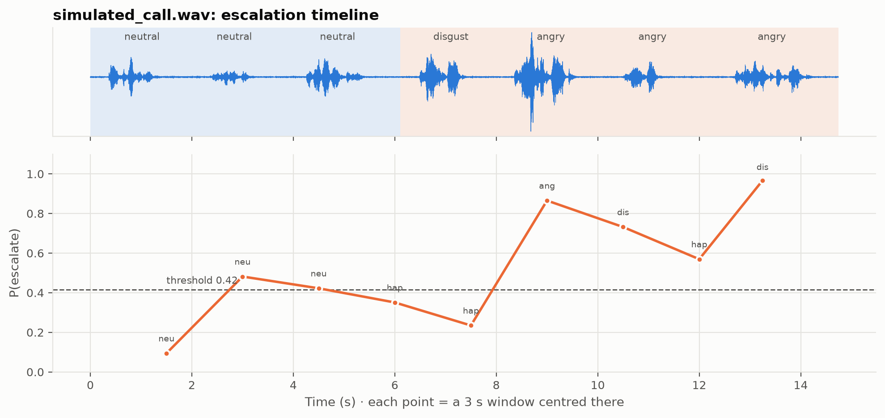
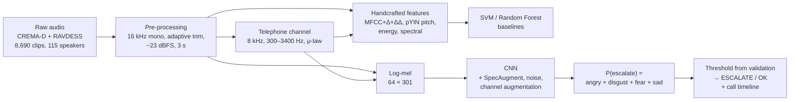

# Speech Emotion Recognition for Early Escalation of Frustrated Customers

**Detect frustrated callers from their voice, robustly on telephone audio, and turn the model's output into an
escalation decision a support team can act on.**


> **Held-out test set (17 unseen speakers), telephone audio:** 6-class macro-F1 **0.64** · catches **90%** of
> frustrated callers · **85%** of alerts correct · false alerts cut by **68%** vs flagging every call

---

## The problem

Contact centres for banking and financial-services (BFSI) clients record thousands of calls a day, but
quality-assurance teams can review only a small sample by hand. Frustrated customers are usually noticed only after a
complaint or a poor CSAT score, when SLA penalties or churn have already happened.

This project builds a **speech emotion recognition (SER)** pipeline that listens to call audio, recognises six
emotions, and flags calls with negative emotion (angry, disgust, fear, sad) for **early escalation and prioritised QA
review**.

Real customer calls are confidential, so the models are trained on two public emotional-speech datasets
(**CREMA-D** and **RAVDESS**), and every clip is also passed through a **simulated telephone channel**
(8 kHz, 300–3400 Hz, G.711 μ-law) to mimic call-centre audio.

## Key results

Held-out test set: 1,274 clips from **17 speakers never used for training or tuning**.

| Model | Macro-F1 (clean) | Macro-F1 (telephone) | Escalate recall | Alert precision | False alerts / 100 calls |
|---|---|---|---|---|---|
| Flag every call (reference) | – | – | 1.00 | 0.67 | 32.8 |
| SVM on MFCC/prosodic features (clean-trained) | 0.542 | 0.209 | 0.88 | 0.70 | 24.8 |
| SVM (multi-condition: clean + telephone) | 0.533 | 0.519 | 0.87 | 0.76 | 18.1 |
| CNN + BiLSTM on log-mel | 0.628 | 0.606 | 0.89 | 0.84 | 11.1 |
| **CNN on log-mel (mean of 3 seeds)** | **0.654 ± 0.010** | **0.642 ± 0.003** | **0.90** | **0.85** | **10.5** |

Escalation columns are on telephone audio, with the alert threshold chosen on **validation** data (≥ 90% recall)
and applied unchanged to the test set. Chance-level macro-F1 is about 0.17.

<p align="center">
  
</p>

### What the project found

1. **The telephone channel breaks naive models.** An SVM trained on clean audio falls from 0.54 to 0.21 macro-F1 on
   telephone audio and labels most clips "happy": the 300 Hz high-pass removes the voice fundamental, and pitch
   features roughly double (median F0 194 → 264 Hz).
2. **Matching the training data to the channel matters most.** Multi-condition training recovers +0.31 macro-F1;
   the CNN's learned spectro-temporal features add a further +0.12.
3. **The model ranks calls well.** If QA reviews only the 20 highest-scoring calls out of 100, 97% are genuinely
   negative (clean-trained SVM: 83%).
4. **The business-critical error is angry → happy (14%).** Both are loud and high-pitched. Angry ↔ disgust confusions
   do not change the escalation decision.

<p align="center">
  
</p>

## Demo: scoring a whole call

`src/predict.py` scores any `.wav` file. Long audio is processed in 3 s windows every 1.5 s, silent windows are
skipped, and the call is flagged when about 4.5 s of speech is consistently negative.

```bash
python src/predict.py results/demo/simulated_call.wav --phone --plot
```

<p align="center">
  
</p>

A simulated call by an **unseen** test speaker (neutral → disgust → angry) is flagged where the anger starts. The
timeline also shows the model's honest weaknesses: one quieter angry take is heard as *happy*, and two neutral windows
sit just above the clip-level threshold.

## Live web demo

A Gradio app records or uploads speech, optionally simulates the telephone channel, and shows the emotion
probabilities, the escalation decision and, for longer audio, the timeline.

```bash
pip install gradio
python app/app.py            # open http://127.0.0.1:7860
```

`python scripts/build_space.py` assembles a ready-to-upload **Hugging Face Space** in `dist/hf-space/`
(5.4 MB, CPU only, no PyTorch).

## Lightweight inference (ONNX): edge-ready

The release CNN is exported to **ONNX** (4.7 MB) and served by a small package, `inference/`, that needs only
NumPy, SciPy, soundfile and ONNX Runtime: no PyTorch or librosa. It is the runtime for the web demo and for
Raspberry Pi deployment.

```bash
pip install -r requirements-inference.txt
python -m inference results/demo/single_angry_CRE_1001.wav            # emotion + decision
python -m inference results/demo/simulated_call.wav --phone --json    # whole call, JSON output
```

```python
from inference import EscalationPredictor
result = EscalationPredictor().predict("call.wav", phone=True)
```

**Parity with the research pipeline** (all 1,274 test clips, `scripts/validate_inference.py`):

| | Clean | Telephone |
|---|---|---|
| Same top emotion as PyTorch | 99.5% | 97.6% |
| Same escalation decision | 99.8% | 99.5% |
| Test accuracy: ONNX package vs PyTorch | 65.6% vs 65.6% | 64.4% vs 64.1% |

The NumPy log-mel matches torchaudio to within 0.005 dB on average; the small telephone differences come from a
different resampler.

**CPU latency per 3 s window** (`scripts/benchmark_inference.py`, laptop AMD Ryzen 7 260):
about 15 ms on one thread and about 6–8 ms on four threads, over 200× faster than real time, with about 175 MB peak
memory. Raspberry Pi 5 numbers will be measured on the device.

## Pipeline



| Stage | Details |
|---|---|
| Data | Six shared emotions; RAVDESS *calm* → neutral, *surprised* dropped. **Speaker-independent** 70/15/15 split, stratified by dataset and sex |
| Pre-processing | Resampling, silence trimming adapted to each clip's noise floor (fixes CREMA-D's high noise floor), RMS normalisation, centre crop / pad |
| Features | 259 handcrafted statistics for the baselines; 64-band log-mel (25 ms / 10 ms) for the CNN |
| Baselines | RBF-SVM and Random Forest tuned with speaker-grouped 5-fold CV |
| CNN | 4 conv blocks (32→256 channels), 1.18 M parameters, AdamW + one-cycle, label smoothing, bfloat16, 60 epochs, 3 seeds |
| Evaluation | Macro-F1, per-class recall, confusion matrices, AUC, alerts / false alerts / missed callers per 100 calls, clean vs telephone |

Full analysis with every figure and table: [`notebooks/SER_Escalation.ipynb`](notebooks/SER_Escalation.ipynb).
Model details: [`docs/MODEL_CARD.md`](docs/MODEL_CARD.md).

## Quick start

**Requirements:** Linux or Windows, [Miniconda](https://docs.conda.io/en/latest/miniconda.html), and an NVIDIA GPU
for training (inference runs on CPU).

```bash
# 1. Environment
conda create -n ser python=3.11 -y
conda activate ser
pip install -r requirements.txt
python -m ipykernel install --user --name ser --display-name "Python 3.11 (ser)"

# 2. Datasets (~1.2 GB; downloads and verifies RAVDESS + CREMA-D into data/raw/)
python src/download_data.py

# 3. Reproduce everything: open notebooks/SER_Escalation.ipynb with the "Python 3.11 (ser)" kernel and Run All.
#    Without saved results the notebook recomputes every step automatically (~90 min on a 12-core CPU + RTX 5060).
```

Individual steps can also be run as scripts from `src/`: `data.py` → `preprocess.py` → `features.py` →
`baseline.py` → `train_cnn.py cnn 42` → `evaluate.py` → `make_demo.py`.

## Repository structure

```
├── src/
│   ├── config.py           paths, labels, constants
│   ├── download_data.py    dataset download + verification
│   ├── data.py             metadata, labels, speaker-independent split
│   ├── preprocess.py       resampling, trimming, normalisation, telephone simulation
│   ├── features.py         handcrafted features + log-mel spectrograms
│   ├── baseline.py         SVM / Random Forest (+ multi-condition SVM)
│   ├── train_cnn.py        CNN and CNN + BiLSTM training with augmentation
│   ├── evaluate.py         held-out test evaluation + business metrics
│   ├── importance.py       grouped permutation feature importance
│   ├── predict.py          prediction for any .wav (clip or whole call)
│   ├── export_onnx.py      ONNX export of the release model
│   └── make_demo.py, eda.py, fig_*.py, plotstyle.py   demo material and figures
├── inference/              lightweight runtime: ONNX Runtime + NumPy front-end (edge-ready)
├── models/                 ser_cnn.onnx, frontend.npz, config.json (CC BY-NC-SA 4.0)
├── app/app.py              Gradio web demo
├── scripts/                parity validation, CPU benchmark, Hugging Face Space builder
├── notebooks/SER_Escalation.ipynb   end-to-end analysis
├── results/                figures, metrics, demo audio and timelines
└── docs/                   DATA.md (sources, licences), MODEL_CARD.md
```

## Limitations

- **Acted speech:** actors reading fixed sentences; real frustration is subtler and builds over a conversation.
- **Simulated channel:** real calls add other codecs (Opus, AMR, G.729), packet loss, echo and background noise.
- **No speaker diarisation:** in real recordings only the customer's voice should be scored.
- **Tone, not words:** a calm "I want to close my account" is still an escalation.
- **Thresholds are clip-level:** a call-level threshold needs calibration on real calls.

The model is intended as **decision support with a human in the loop**, not for automated decisions about customers.

## Roadmap

- [x] ONNX export and a lightweight inference package (ONNX Runtime, NumPy front-end), validated against PyTorch
- [x] Live web demo (Gradio); Hugging Face Space bundle ready to deploy
- [ ] **Edge deployment on Raspberry Pi 5**: live microphone input, on-device inference, latency benchmark
- [ ] Validation and fine-tuning on authorised, anonymised real call recordings
- [ ] Speaker diarisation and voice activity detection for full calls
- [ ] Self-supervised speech encoders (wav2vec 2.0 / WavLM) and fusion with speech-to-text sentiment
- [ ] Call-level threshold calibration and drift monitoring

## Tech stack

Python · PyTorch · torchaudio · librosa · scikit-learn · ONNX / ONNX Runtime · Gradio · NumPy / SciPy / pandas ·
matplotlib · Jupyter

## Data and licences

- **Code:** MIT ([LICENSE](LICENSE)).
- **Datasets** (not included; downloaded by `src/download_data.py`):
  - CREMA-D: Cao, H. et al. (2014). *CREMA-D: Crowd-sourced Emotional Multimodal Actors Dataset.* IEEE Transactions on
    Affective Computing 5(4). Open Database License.
  - RAVDESS: Livingstone, S. R. & Russo, F. A. (2018). *The Ryerson Audio-Visual Database of Emotional Speech and Song.*
    PLoS ONE 13(5). CC BY-NC-SA 4.0.
- **Trained model weights** (`models/`): CC BY-NC-SA 4.0, as they are derived from RAVDESS (non-commercial use).
  Details in [`docs/DATA.md`](docs/DATA.md).

## Author

**Muhammad Kassali K**: built end to end, from data pipeline and signal processing to model training, evaluation
and business mapping.
